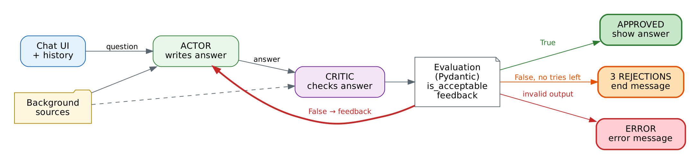

# Profile Chatbot – Actor / Critic

**Submitted by:** Lavie Zanzuri, Michael Shampaner  
**Lecturer:** Dr. Paul Avrahami

A chat application that represents Lavie Zanzuri, based on a LinkedIn profile and a personal summary.
For every question, the **Actor** writes a draft answer and the **Critic** reviews it, returning structured output that is validated with Pydantic.
An approved answer is shown to the user. A rejected answer goes back to the Actor with feedback, up to 3 attempts per question.



Detailed diagram: [docs/architecture_detailed.png](docs/architecture_detailed.png)

## Requirements
- Python 3.11 (tested on 3.11.13)
- An OpenAI API key

## Installation
```bash
python3.11 -m venv .venv
source .venv/bin/activate        # Windows: .venv\Scripts\activate
pip install -r requirements.txt
```

## Environment setup
```bash
cp .env.example .env
```
Then set the following in `.env`:
```
OPENAI_API_KEY=sk-...
ACTOR_MODEL=gpt-5.4-mini
CRITIC_MODEL=gpt-5.4-mini
MAX_ATTEMPTS=3
```
`.env` is listed in `.gitignore` and is not in the repository. Only `.env.example`, with the variable names, is committed.

Check the connection:
```bash
python check_setup.py
```

## Running the chat
```bash
python -m src.app
```
Then open http://127.0.0.1:7860.
Below the chat there is a collapsible **"Audit log"** panel (יומן בדיקה) that shows the drafts, the Critic's decisions and its feedback.
Each UI run is also saved to `logs/session_<timestamp>.json`.

## Running the tests
| Command | What it checks | Uses API |
|---|---|---|
| `python -m tests.try_actor` | Actor: existing info, follow-up, missing info, revision | Yes |
| `python -m tests.try_critic` | Pydantic validation of valid and broken outputs, and Critic decisions | Partly |
| `python -m tests.try_loop` | The loop's 3 exit paths with a fake Actor/Critic, plus one real question | Partly |
| `python -m tests.run_scenarios` | **The 5 required scenarios** | Yes |

`run_scenarios` saves its results to `logs/scenarios/`: one `scenario_<N>.json` per scenario, and `summary.md` with expected vs. actual behavior.
To run a single scenario: `python -m tests.run_scenarios 4`.

- **Scenario 4** injects a flawed first draft through `forced_first_draft`. The Critic and the revision use the language model.
- **Scenario 5** uses a **mock Critic** (`src/mock_critic.py`) that rejects every answer. It is a control-flow test only: it is marked `critic: "mock"` in the log and reported separately in the summary.

## Models and settings
| Component | Model | Settings |
|---|---|---|
| Actor | `gpt-5.4-mini` | OpenAI Responses API, default model parameters |
| Critic | `gpt-5.4-mini` | Responses API with Structured Outputs (`json_schema`, `strict: true`), then Pydantic validation |
| Attempt limit | 3 per question | Including the first answer |
| History given to the Critic | Last 6 messages | `RELEVANT_HISTORY_MESSAGES` in `src/critic.py` |

## Project structure
```
data/            Background sources: linkedin.txt, summary.txt
prompts/         actor_system.txt (Actor instructions), critic_system.txt (System Evaluator)
src/
  config.py      Loads settings from .env
  background.py  Loads the background sources
  actor.py       Actor: generate()
  evaluation.py  Pydantic model Evaluation
  critic.py      Critic: evaluate(), builds the User Evaluator and validates the output
  loop.py        Loop: handle_question(), exit paths approved / max_attempts / technical_error
  mock_critic.py Mock Critic for scenario 5
  audit_log.py   Audit log (JSON)
  app.py         Gradio UI
tests/           Test scripts and the scenario runner
logs/scenarios/  Logs and summary of the 5 scenarios
docs/            Architecture diagrams: architecture (simple), architecture_detailed
screenshots/     Screenshots
REPORT.md        Report (Hebrew)
```