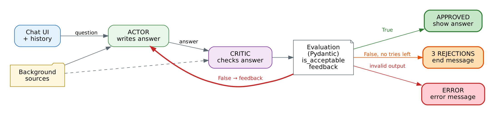

# דוח: צ'אט פרופיל עם Actor ו-Critic

**מגישים:** לביא זנזורי (Lavie Zanzuri), מיכאל שמפנר (Michael Shampaner) · **מודלים:** Actor `gpt-5.4-mini`, Critic `gpt-5.4-mini` · **מגבלת ניסיונות:** 3

## 1. ארכיטקטורה

תרשים מפורט, עם שמות הקבצים, ההיסטוריה ויומן הבדיקה: [docs/architecture_detailed.png](docs/architecture_detailed.png)

כל שאלה של המשתמש נכנסת ללולאה (`src/loop.py`):

1. **היוצר** מקבל את מקורות הרקע, את היסטוריית השיחה ואת השאלה, ומפיק תשובה מועמדת. ה-System Prompt מחייב לבסס כל עובדה אישית על המקורות, ולומר במפורש כשאין מידע.
2. **המעריך** מקבל את אותם מקורות, את 6 ההודעות האחרונות בשיחה, את השאלה ואת התשובה המועמדת. הוא בודק ארבעה קריטריונים: ביסוס במקורות, מענה לשאלה, טיפול במידע חסר, ובהירות. הפלט הוא JSON לפי סכמה קשיחה, והקוד מאמת אותו מול מודל ה-Pydantic `Evaluation`.
3. **אישור** (`is_acceptable=True`): התשובה מוצגת למשתמש ונוספת להיסטוריה.
4. **דחייה:** הטיוטה שנדחתה והמשוב חוזרים ליוצר, שכותב גרסה מתוקנת, והמעריך בודק אותה מחדש. זו קשת המשוב באדום בתרשים.
5. **מיצוי ניסיונות:** אחרי הדחייה השלישית מוצגת הודעה שלא התקבלה תשובה מאושרת, ואף טיוטה שנדחתה לא מוצגת.
6. **שגיאה טכנית:** אם קריאה למודל נכשלת או שהפלט לא עובר אימות, הטיפול בשאלה נעצר עם הודעת שגיאה, וביומן נרשם `not_completed` במקום החלטה.

ההחלטה אם להמשיך נשענת רק על השדה הבוליאני אחרי האימות, ולא על חיפוש מילים בטקסט. ההיסטוריה המוצגת כוללת רק הודעות משתמש ותשובות סופיות. הטיוטות והמשוב נשמרים ביומן בדיקה נפרד, בקובץ JSON ובפאנל בממשק.

## 2. תוצאות

| # | תרחיש | מקור ההערכה | מצב סיום | ניסיונות | תאם לציפייה |
|---|---|---|---|---|---|
| 1 | שאלה על מידע קיים (ההתמחות) | מודל שפה | approved | 1 | ✅ |
| 2 | שאלת המשך ("באילו טכנולוגיות השתמשת **בו**?") | מודל שפה | approved / approved | 1 / 1 | ✅ |
| 3 | פרט שאינו במקורות (ממוצע) | מודל שפה | approved | 1 | ✅ |
| 4 | טיוטה פגומה, דחייה ותיקון | מודל שפה (טיוטה 1 מוזרקת) | approved | 2 | ✅ |
| 5 | מיצוי ניסיונות | **מעריך מדומה**, בדיקת זרימת בקרה | max_attempts | 3 | ✅ |

היומנים המלאים נמצאים ב-`logs/scenarios/`, והסיכום המפורט ב-`logs/scenarios/summary.md`. צילומי המסך נמצאים ב-`screenshots/`.

**תרחיש 1:** התשובה נתמכת ב-`linkedin.txt`, בחלק Experience, בשורה "TracePCB – Software Engineer Intern, July 2026 – September 2026" ובשלוש הנקודות שמתחתיה.
**תרחיש 2:** בתור השני היוצר הבין שהמילה "בו" מתייחסת ל-Escape the Query Room, וענה React, Flask ו-Google Gemini API. כלומר ההקשר נשמר.
**תרחיש 3:** התשובה הייתה "אין לי מידע על הממוצע שלי במקורות שעומדים לרשותי", והיא הפנתה רק ללימודים שמופיעים במקורות: רייכמן והאוניברסיטה הפתוחה.

## 3. כיצד המשוב שינה תשובה (תרחיש 4)

הטיוטה הראשונה הוזרקה בכוונה:
> "עבדתי כמתמחה ב-TracePCB, ולפני כן עבדתי שנתיים כמפתח Backend בחברת Wix, שם הובלתי צוות של חמישה מפתחים."

המעריך **דחה** אותה. במשוב הוא ציטט את שתי הטענות שלא נתמכות ("חברת Wix" ו"הובלתי צוות של חמישה מפתחים"), ציין שהתפקיד ב-TracePCB היה Software Engineer Intern ולא מפתח Backend, קבע שהופר קריטריון A, והנחה לציין רק את החברות שמופיעות במקורות, TracePCB ו-Israel Defense Forces.
היוצר קיבל את הטיוטה שנדחתה ואת המשוב, והגרסה המתוקנת הייתה "עבדתי ב-TracePCB וב-Israel Defense Forces (צה"ל)." היא **אושרה** בניסיון השני. שתי הטענות המומצאות הוסרו, ונשארו רק עובדות שמופיעות במקורות. זה מראה שלולאת התיקון משתמשת בפועל במשוב, ולא רק מייצרת שוב תשובה מאפס.

## 4. למה תקינות הסכמה לא מבטיחה תשובה נכונה

אימות Pydantic בודק **מבנה**: שיש שני שדות, ש-`is_acceptable` הוא ערך בוליאני אמיתי ולא המחרוזת `"yes"`, שהמשוב לא ריק ושאין שדות מיותרים. בבדיקה `tests/try_critic.py` נדחו כל חמשת הפלטים הפגומים: שדה חסר, סוג שגוי, שדה מיותר, טקסט שאינו JSON, ופלט ריק.
אבל אובייקט כמו `{"is_acceptable": true, "feedback": "Supported by the sources."}` תקין לגמרי מבחינת הסכמה, גם אם התשובה שהוא מאשר ממציאה עובדה. הסכמה מבטיחה שאפשר לקרוא את ההחלטה בצורה אמינה, ולא שההחלטה נכונה. הנכונות תלויה בשיקול הדעת של מודל המעריך, שגם הוא מודל שפה שעלול לטעות. לכן עדיין צריך בדיקה ידנית מול המקורות.

## 5. בדיקה ידנית של תשובות שאושרו ומגבלת המעריך

**תשובה 1, תרחיש 1 (ההתמחות):** השוויתי כל טענה ל-`linkedin.txt`. החברה והתפקיד, יולי עד ספטמבר 2026, החיבור בין monday.com API ל-Claude Code, אלפי רשומות CRM, workflows מונעי אירועים ב-monday.com, רצפי מיילים אוטומטיים, ו-workflow ליצירת לידים שהרחיב את צינור המכירות מופיעים כולם במקור. **לא נמצאה טענה לא מבוססת.**

**תשובה 2, תרחיש 2, התור הראשון (Escape the Query Room):** משחק full-stack ללימוד SQL, 3 חדרי בריחה, 5 שלבים ברמות קושי עולות, React, Flask ורמזים מ-Google Gemini API. כל אלה מופיעים ב-`summary.txt`. **לא נמצאה טענה לא מבוססת.**

**המגבלה שזיהיתי:** המעריך בודק היטב **טענות עובדתיות מפורשות**. הוא זיהה את Wix ואת ניהול הצוות בתרחיש 4, ואפילו את הניסוח השגוי של התפקיד. אבל בריצות קודמות, במהלך הפיתוח, הוא אישר שני סוגי בעיות:

1. **הצעות המשך שאין להן כיסוי.** בריצה קודמת של תרחיש 2, התשובה לאותה שאלה הסתיימה ב: "אם תרצה, אני יכול גם לספר בקצרה על הארכיטקטורה או האתגרים הטכניים בפרויקט." אין במקורות שום מידע על הארכיטקטורה או על אתגרים בפרויקט, ובכל זאת המעריך אישר. הוא לא מתייחס להבטחות ולהצעות כאל טענות שצריך לבסס, אף על פי שהן מרמזות שיש ידע שאינו קיים.
2. **קריטריון הסגנון מקל.** בשיחה בממשק (`logs/session_20261125_131335.json`) המעריך אישר תשובה עם הדגשות Markdown ועם הפניה מכנית, "לפי המקורות, הפרויקט כלל...", בצ'אט שאמור לדבר בגוף ראשון וטבעי.

בנוסף, **התשובות לא דטרמיניסטיות**. אותה שאלה בתרחיש 2 קיבלה בריצה אחת תשובה עם הצעה לא מבוססת, ובריצה אחרת תשובה נקייה. כלומר, ריצה אחת שעברה את המעריך לא מוכיחה שהמערכת אמינה. צריך להריץ כמה פעמים, ולבדוק ידנית מדגם של תשובות שאושרו.

**שיפור אפשרי:** להוסיף להנחיות המעריך שכל הצעה להמשך שיחה חייבת להיות מבוססת על המקורות, ולהוסיף להנחיות היוצר איסור על הצעות כאלה ועל שימוש ב-Markdown.